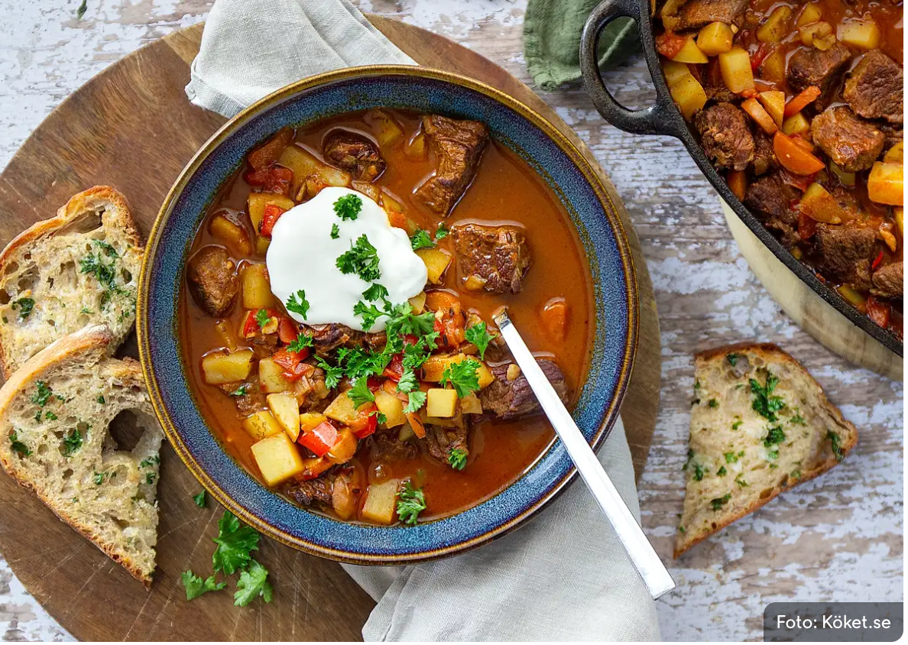

# Gulasch soppa

## Ingredienser

- 800 g högrev (Från Sverige)

- 1 gul lök (Från Sverige)

- 2 klyftor vitlök (Från Sverige)

- 2 röda paprikor (Från Sverige)

- 1 palsternacka (Från Sverige)

- 2 morötter (Från Sverige)

- olja, till stekning (Från Sverige)

- smör, till stekning (Från Sverige)

- 3 msk tomatpuré

- 1 msk hel kummin

- 2 msk paprikapulver

- 0,5-1 tsk cayennepeppar

- 2 msk kalvfond

- ca 6 dl vatten

- 33 cl öl

- 4 potatisar (Från Sverige)

- salt

- peppar

## Gör så här

1. Skär högrevet i lagom stora grytbitar.

1. Skala och finhacka lök och vitlök. Dela, kärna ur och skär paprikan i mindre bitar. Skölj och skär morot och palsternacka i små slantar eller kvartar.

1. Bryn köttet i smör och olivolja på hög värme i en stor gryta tills det har fått rejält med färg. Stek gärna i omgångar så grytan behåller värmen och köttet för en bra yta.

1. Tillsätt paprika, lök, vitlök, palsternacka och morot och låt fräsa med i några minuter.

1. Tillsätt tomatpurén och de torkade kryddorna och rosta tillsammans med grönsakerna i grytan.

1. Häll på öl, fond och vatten så att det täcker. Låt puttra under lock ca 1,5 timme.

1. Skala och skär potatisen i cm-stora bitar. Lägg ner potatisen i grytan och låt koka ytterligare ca 20 minuter, tills potatisen är mjuk.

1. Smaka av med salt och svartpeppar.

Orginal recept från [köket.se](https://www.koket.se/klassisk-gulaschsoppa-med-vitloksbrod)

